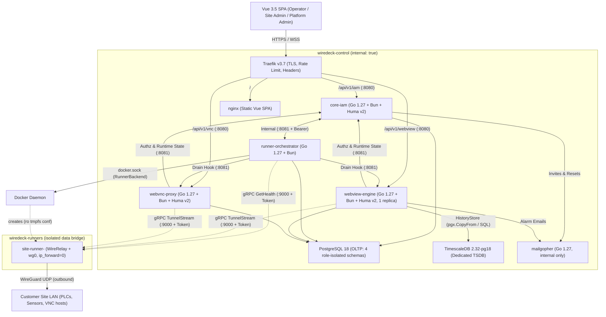

# WireDeck2 — Locked Architecture & Execution Plan (v2.2)

**Date:** 2026-11-22 · **Status:** Stack & Datastores Locked · Pending final confirmation on UI Admin Separation  
**Baseline Reviewed:** `WireDeck2/docs/ARCHITECTURE.md` (v2.0), `docs/k8s-host.md`, `db/`, `services/*/prisma/`, `deploy/docker-compose.yml`, `WireDeck` (v1), `WireRelay` (`v1.0.1`), `MailGopher` (`v1.1.0`).

---

## 1. Locked Architectural Decisions

| Area | Locked Choice |
|---|---|
| **Backend Language & Framework** | **100% Go `1.27.2`** across all 4 services (`core-iam`, `runner-orchestrator`, `webvnc-proxy`, `webview-engine`) + `WireRelay` + `MailGopher`, sharing a common `pkg/` layer. |
| **ORM & SQL Driver** | **`uptrace/bun` `v1.3.0`** + **`jackc/pgx/v5` `v5.13.0`** (with `pgx.CopyFrom` binary bulk inserts for time-series ingestion and `pressly/goose/v3` embedded SQL migrations). |
| **HTTP Validation & OpenAPI** | **`go-chi/chi/v5`** + **`danielgtaylor/huma/v2`**: **100% schema-validated** inputs (strict JSON Schema validation, rejecting unknown fields, typed path/query/header/body structs) + **auto-generated OpenAPI 3.1 + interactive Swagger/Scalar UI** directly from Go types (zero YAML drift). |
| **Admin vs. User API Separation** | **Strict router-level separation** into dedicated `/admin/*` sub-routers with group-level RBAC middleware (`RequirePlatformAdmin`, `RequireSiteAdmin`), separate OpenAPI tags/groups, and separate `:8081` internal port for service-to-service endpoints. |
| **Datastores (Separated)** | **OLTP:** `postgres:18.7-alpine` (4 role-isolated schemas: `platform_iam`, `platform_runners`, `platform_webvnc`, `platform_webview`; trivial `pg_dump` backups). **TSDB:** Separate `timescale/timescaledb:2.32.1-pg18` instance (`platform_webview_history` hypertable, compression, `1m`/`1h` continuous aggregates, `time_bucket_gapfill` + `locf()`, 30d raw / 1y rollup retention), accessed via a `HistoryStore` Go interface. |
| **VNC Passwords (D25)** | **Server-side only.** `webvnc-proxy` completes the RFB 3.8 DES challenge-response with the target using `password_encrypted` (`VNC_PASSWORD_ENCRYPTION_KEY`) and presents `SecurityType=None` to browser `noVNC`. |
| **User Lifecycle & Auth (D29)** | **Admin-created users via email invite** (`MailGopher`, 48 h single-use `INVITE` token). Users can **change their password anytime** (authenticated change-password + unauthenticated email `PASSWORD_RESET` flow). `HttpOnly; Secure; SameSite=Strict` rotating refresh cookie + in-memory RS256 access JWT (`kid` rotation). |
| **Versions Policy** | **Latest stable** libraries, frameworks, and images everywhere, pinned to explicit stable tags (never `:latest`). |
| **Deployment & K8s Path** | Built for **Docker Compose** now, engineered with clean Go seams (`RunnerBackend`, `OwnershipProvider`, `LeaderElector`, `HistoryStore`, `RESERVED_CIDRS`) so migrating to **Kubernetes** changes runtime wiring/workmodes without rewriting any service. |

---

## 2. Current State of Workspace (Ground Truth)

- **`WireDeck2/` (14 files, no Git repo, zero application code):** Contains `ARCHITECTURE.md` (v2.0), `k8s-host.md`, raw SQL migrator `db/sql/001`–`006` ([005_history.sql](file:///home/administrator/personal/WireDeck-All/WireDeck2/db/sql/005_history.sql) missing `-- NO_TRANSACTION`), legacy Prisma schemas (now superseded by Go + Bun + SQL migrations), and a draft [docker-compose.yml](file:///home/administrator/personal/WireDeck-All/WireDeck2/deploy/docker-compose.yml).
- **[WireDeck](file:///home/administrator/personal/WireDeck-All/WireDeck/CLAUDE.md) (v1):** Production reference (`wireguard-manager v1.3.1`, `webview v1.1.0`); informs v2 parity for `button`/`number_input` widgets and write-only registers.
- **[WireRelay](file:///home/administrator/personal/WireDeck-All/WireRelay/cmd/wirerelay/main.go) (`v1.0.1`):** All Phase-0 hardening items (**R1–R9**) are open, plus **R10** (REST `/health` sets `Content-Type` after `WriteHeader`) and **R11** (`GracefulStop` hangs indefinitely on open `TunnelStream`s + enforce `ip_forward=0`).
- **[MailGopher](file:///home/administrator/personal/WireDeck-All/MailGopher/main.go) (`v1.1.0`):** Has 3 runtime bugs: **M1** (closed-channel panic on retry during graceful shutdown), **M2** (pre-send `<-ticker.C` delays even the first idle invite/alarm email by up to 72 s), and **M3** (divide-by-zero panic if `limit_per_hour <= 0`).

---

## 3. Target Architecture (v2.2)

### 3.1 Topology & Network Segmentation

### 3.2 Critical Security & Lifecycle Fixes Baked In

1. **Network Isolation (D20):** `wiredeck-control` (`internal: true`) vs. `wiredeck-runners`. Compromised runners cannot route to Postgres 18, TimescaleDB, `core-iam`, `mailgopher`, or Traefik.
2. **Dual-Port Separation & Internal Auth (D21):** Public Traefik traffic hits `:8080`; internal service APIs bind on `:8081` (`wiredeck-control` only) with `INTERNAL_API_TOKEN`. `runner-orchestrator` binds its HTTP API strictly on its `wiredeck-control` IP.
3. **Reboot-Safe Tmpfs Recovery (D22):** `runner-orchestrator` pulls desired specs (`GET /internal/runners/desired`) and missing confs (`GET /internal/sites/:siteId/runner-conf`) from `core-iam:8081` during boot/reconcile.
4. **Separate Encryption Keys (D23):** `WG_CONF_ENCRYPTION_KEY` (`core-iam`) vs. `VNC_PASSWORD_ENCRYPTION_KEY` (`webvnc-proxy`).
5. **Cross-Service Lifecycle Propagation (D28):** `GET /internal/sites/runtime-state` (polled every 10–15 s) propagates `isActive`, `status` (drives D12 offline alarm freeze), feature flags, and `lanSubnets`. `POST /internal/sites/:siteId/drain` handles graceful conf rotation; `DELETE /internal/sites/:siteId/data` handles site deletion cascades (including TSDB purge).
6. **TimescaleDB Dedicated Instance & Migration Fix:** Separate `timescale/timescaledb:2.32.1-pg18` container with `-- NO_TRANSACTION` fixed on `005_history.sql`, `pgx.CopyFrom` batched writes, `1m`/`1h` continuous aggregates, and `time_bucket_gapfill` + `locf()` for continuous deadband charts.

---

## 4. API Architecture: Schema Validation, OpenAPI & Admin/User Separation

### 4.1 Schema Validation & OpenAPI Documentation (Go + Huma v2)

Every public HTTP service (`core-iam`, `webview-engine`, `webvnc-proxy`) uses **`go-chi/chi/v5` + `danielgtaylor/huma/v2`**:
- **Strict Schema Validation:** Every path param, query param, header, and JSON body is declared as a Go struct with validation tags (`required`, `minLength`, `maxLength`, `minimum`, `maximum`, `format:"email|uuid|ipv4"`, `enum:"..."`) plus `additionalProperties: false` so unknown fields are rejected with RFC 9457 `422 Unprocessable Entity` Problem Details.
- **Zero-Drift OpenAPI 3.1 + Interactive Docs:**
  - Each service publishes its live OpenAPI 3.1 JSON (`/api/v1/<svc>/openapi.json`) and interactive Swagger/Scalar docs (`/api/v1/<svc>/docs`) — enabled in dev by default and toggleable via `ENABLE_OPENAPI_DOCS` (or restricted to admins in prod).
  - OpenAPI specs are cleanly grouped with explicit tags & security schemes (`BearerAuth`, `PlatformAdmin`, `SiteAdmin`) and can be used to auto-generate TypeScript API clients/types (`openapi-typescript`) for the Vue 3 frontend!

### 4.2 Strict Admin vs. Non-Admin Endpoint Separation

Admin and non-admin routes live in **distinct URL namespaces** and **separate `chi`/`huma` router groups**, so authorization is enforced structurally at the group middleware level (impossible to accidentally forget an admin guard on a single handler):

| Tier | URL Namespace | Group Middleware | Examples |
|---|---|---|---|
| **Public (Unauth)** | `/api/v1/iam/auth/*`, `/.well-known/jwks.json` | Rate limit only | Login, refresh cookie, accept-invite, forgot/reset password, JWKS |
| **Authenticated User (Self)** | `/api/v1/iam/me/*` | `RequireAuth` | Profile, change password, active sessions, accessible site list |
| **Operator / Site User** | `/api/v1/webview/sites/{siteId}/*`, `/api/v1/vnc/sites/{siteId}/*`, `/api/v1/webview/alarms` | `RequireAuth` + `RequireSiteMember` (+ `RequireSiteRW` for Modbus write) | Read dashboards, live WS stream, history charts, ack alarms, Modbus write (`RW`), VNC ticket/stream |
| **Site Admin** | `/api/v1/{iam,webview,vnc}/sites/{siteId}/admin/*` | `RequireAuth` + `RequireSiteRole(SITE_ADMIN)` *(or Platform Admin)* | Upload/rotate WG conf, toggle site flags, manage Devices, Register Mappings, Dashboards/Widgets, Alarm Rules, VNC Targets |
| **Platform Admin** | `/api/v1/iam/admin/*` | `RequireAuth` + `RequirePlatformAdmin` | Create/invite/disable users, create/activate/deactivate/delete sites, assign site memberships, inspect/restart runners |
| **Internal Control Plane** | `:8081/internal/*` | `RequireInternalToken` + `wiredeck-control` bind | Never routed by Traefik, never in public OpenAPI |

---

## 5. Admin vs. Normal User Separation on the UI (Design Evaluation)

How should admin actions be separated from normal users in the Vue 3 frontend? Here are the three architectural approaches:

| Approach | How It Works | Pros | Cons |
|---|---|---|---|
| **1. Role + Dynamic Render Only** *(inline `v-if` buttons)* | One shared layout; "Edit/Delete/Add" buttons appear inline on operator pages based on role. | Fastest to prototype initially. | Clutters live industrial operator screens; easy to accidentally click edit/delete while monitoring; admin JS ships to every operator; hard to apply network/IP restrictions to platform admin routes. |
| **2. Two Completely Separate Frontend Apps** (`app.domain` + `admin.domain`) | Two separate Vite projects/containers/domains. | Maximum physical separation for Platform Admin. | **Poor UX for `SITE_ADMIN`**: a site engineer adding a PLC register or tweaking a dashboard card has to switch apps/domains just to test live values or VNC! Duplicates auth, Tailwind theme, UI primitives, and API client builds. |
| **3. Dual-Shell / Three-Surface Modular SPA** *(Recommended)* | **One Vue 3 + Vite app** split into **three isolated route trees, dedicated layouts, and lazy-loaded Vite chunks** (`admin/*`, `site-admin/*`, `operator/*`), backed by the strict `/admin/*` backend APIs. | **Zero clutter for operators** (never see admin chrome or download admin chunks); **clean Platform Admin Console (`/admin/*`)** with its own shell; **one-click Site Config mode (`/sites/:siteId/admin/*`)** so `SITE_ADMIN` can configure PLCs/dashboards and immediately verify live values; **Traefik-restrictable** (`/admin` + `/api/v1/*/admin/*` can be IP-allowlisted without code changes!). | Slightly more initial router/layout structure than Approach 1 (trivial — ~3 layout files). |

### How Approach 3 (Recommended) Works in Practice

1. **Operator Shell (`OperatorLayout.vue`):**
   - Routes: `/sites/:siteId/{overview, webview, vnc, history, alarms}`, `/alarms`, `/profile` (change password).
   - Purely operational: monitor live telemetry, operate switches/buttons/setpoints (`SITE_USER_RW+`), open VNC, analyze history, acknowledge alarms. **Zero config forms or destructive admin buttons anywhere in this shell.**
2. **Site Admin Workspace (`SiteAdminLayout.vue` — lazy-loaded chunk):**
   - Routes: `/sites/:siteId/admin/{settings, devices, registers, dashboards, vnc-targets, alarm-rules}`.
   - Visible **only** to `SITE_ADMIN` (for that site) and `PLATFORM_ADMIN` via a clearly delineated **"Site Settings"** mode switcher in the site header (visually distinct banner/accent so an admin always knows they are in Configuration Mode, with a 1-click **"Back to Live View"** button).
3. **Platform Admin Console (`PlatformAdminLayout.vue` — lazy-loaded chunk):**
   - Routes: `/admin/{sites, users, runners}`.
   - Completely separate top-level shell & sidebar (distinct visual accent, accessible via **"Admin Console"** switcher only when `auth.isPlatformAdmin === true`).
   - Regular users never download `PlatformAdmin` or `SiteAdmin` JS bundles, and route guards redirect unauthorized attempts before mount (while backend `/admin/*` middleware enforces the real security boundary).

> [!TIP]
> If in the future you ever want Platform Admin on a separate subdomain (e.g., `admin.example.com`) or VPN-only ingress, Approach 3 already keeps `src/modules/platform-admin/` self-contained and all Platform Admin APIs under `/api/v1/iam/admin/*` — splitting or Traefik-gating it later takes minutes, not a rewrite.

---

## 6. Locked Stack & Latest Stable Versions (Nov 2026)

| Component | Pinned Stable Version |
|---|---|
| **Go** | `1.27.2` (`golang:1.27-alpine`, static `CGO_ENABLED=0` distroless/scratch binaries) |
| **Go Libraries** | `uptrace/bun v1.3.0`, `jackc/pgx/v5 v5.13.0`, `go-chi/chi/v5`, `danielgtaylor/huma/v2`, `coder/websocket`, `lestrrat-go/jwx/v3`, `pressly/goose/v3`, `google.golang.org/grpc`, `prometheus/client_golang` |
| **OLTP Database** | `postgres:18.7-alpine` |
| **Time-Series Database** | `timescale/timescaledb:2.32.1-pg18` |
| **Reverse Proxy** | `traefik:v3.7` (`v3.7.19`) |
| **Frontend** | Vue `3.5.x`, Vite `8.3.x`, TypeScript `5.x`, Pinia, Vue Router, Tailwind CSS v4, ECharts, `@novnc/novnc`, `openapi-typescript`, served by `nginx:1.27-alpine` (built on `node:26-alpine` + `pnpm@10`) |

### Kubernetes-Readiness Seams Built Into v1

| Seam | Docker Compose (v1) | Kubernetes (Future) |
|---|---|---|
| **`RunnerBackend`** (`runner-orchestrator`) | Docker SDK + host tmpfs bind mount | `client-go` Deployment + headless Service + Secret (`checksum/conf`) |
| **`OwnershipProvider`** (`webview-engine`) | `SingleReplicaOwnership` | `client-go` `coordination.k8s.io/v1` Lease per site |
| **`LeaderElector`** (`core-iam`, `runner-orchestrator`) | `NoopLeader` | `client-go` `leaderelection` Lease |
| **`HistoryStore`** (`webview-engine`) | Dedicated TimescaleDB (`pgx.CopyFrom` + `time_bucket_gapfill`/`locf()`) | External/managed TimescaleDB or CNPG/Timescale operator |
| **`RESERVED_CIDRS`** (`core-iam`) | `172.21.0.0/20,172.22.0.0/20` | Pod CIDR + Service CIDR |

---

## 7. Phased Implementation Plan (P0 → P4)

### Phase 0 — Hardening Sibling Helpers & WireDeck2 Go/DB Foundations
1. **`WireRelay/` (`v1.1.0`, Go 1.27):** Implement **R1–R11** (`TunnelClose` + `HandshakeState` proto additions, half-close/fd leak fixes, gRPC keepalive + stream cap, `WIRERELAY_AUTH_TOKEN` interceptor, DDNS periodic re-resolve, REST `/health` header fix, shutdown-aware `TunnelStream` so `GracefulStop` exits cleanly, `:ro` entrypoint tmpfs copy, `ip_forward=0` / `FORWARD DROP`, Go test suite).
2. **`MailGopher/` (`v1.2.0`, Go 1.27):** Implement **M1–M3** (fix shutdown closed-channel retry panic, burst-1 token bucket so idle invite/alarm emails send immediately, validate `limit_per_hour >= 1`, Go test suite).
3. **`WireDeck2/` Repo & Scaffolding:**
   - `git init`, `.gitignore`, `README.md`, `CLAUDE.md`, Go workspace/monorepo layout (`pkg/`, `services/{core-iam,runner-orchestrator,webvnc-proxy,webview-engine}/`, `frontend/`).
   - Remove obsolete Prisma directories (`services/*/prisma`), update `docs/ARCHITECTURE.md` (v2.2) & `docs/k8s-host.md`, create `docs/WIREGUARD-CONF.md`.
   - Split `db/` into clean bootstrap migrators:
     - `db/oltp/` (`postgres:18.7-alpine`: `citext`/`pgcrypto`, 4 schemas & 4 isolated roles; per-service tables managed by each service's embedded `goose` migrations).
     - `db/tsdb/` (`timescale/timescaledb:2.32.1-pg18`: `platform_webview_history` schema/role, fixed `005_history.sql` with `-- NO_TRANSACTION`, `006_continuous_aggregates.sql`).
   - Updated `deploy/docker-compose.yml` (`wiredeck-control` + `wiredeck-runners`, `postgres-oltp` PG18, `postgres-tsdb` TimescaleDB 2.32-pg18, Traefik v3.7, MailGopher, healthchecks), `deploy/.env.example`, `deploy/traefik/{traefik,dynamic}.yml`, and `deploy/docker-compose.dev.yml` (Modbus TCP simulator + password-protected VNC target + test WG peer).
   - **Gate P0:** `WireRelay` & `MailGopher` tests pass; both `oltp-migrator` (PG18) and `tsdb-migrator` (TimescaleDB) run cleanly and idempotently.

### Phase 1 — Control Plane & Tunnel Vertical Slice (`core-iam`, `runner-orchestrator`, SPA Shells)
1. **`pkg/` shared Go packages:** `api` (Huma v2 + Chi setup, RFC 9457 error formatting, OpenAPI registration, RBAC middlewares), `auth` (RS256 JWKS verifier + internal Bearer middleware), `crypto` (AES-256-GCM), `wireguard` (conf parser/validator/normalizer), `wirerelay` (generated gRPC client + auth metadata), `telemetry` (`slog`, correlation ID, `/healthz`, `/readyz`, `/metrics`), `k8s` (`LeaderElector` seam).
2. **`services/core-iam`:** Bun models + `goose` migrations (`users`, `user_tokens`, `refresh_tokens`, `sites`, `site_memberships`). Strict public/user/site-admin/platform-admin OpenAPI routes (`:8080`) + internal `:8081` routes (`/internal/sites/:id/authz`, `/internal/sites/runtime-state`, `/internal/runners/desired`, `/internal/sites/:id/runner-conf`). Email invite & password reset via `MailGopher`, self-service change-password, 15 s status projection loop, idempotent `INIT_ADMIN` bootstrap.
3. **`services/runner-orchestrator`:** `RunnerBackend` + Docker SDK backend, `wiredeck-control`-only HTTP API, drain-before-recreate, reboot-safe 60 s reconcile loop pulling missing tmpfs confs from `core-iam:8081`, 30 s persistent-gRPC health loop → `runners` & `runner_health_events`.
4. **`frontend/` (Vue 3.5 + Vite 8 + TS + Tailwind v4 + Pinia + `openapi-typescript`):** Auth pages (Login, Accept Invite, Forgot/Reset Password, Profile/Change Password), `OperatorLayout` (`SiteOverview.vue`), `PlatformAdminLayout` (`AdminSitesView` with WG conf narrowing wizard, `AdminUsersView` with email invite & resend), `SiteAdminLayout` (`SiteSettingsView`).
   - **Gate P1:** Admin invites user via email → user sets password, logs in, changes password → admin uploads `0.0.0.0/0` WG conf → narrowed & runner connects → `SiteOverview` shows `ONLINE` → wipe tmpfs + restart orchestrator → self-heals; OpenAPI Swagger docs verified on `/docs`.

### Phase 2 — Browser VNC Vertical Slice (`webvnc-proxy`, `VncView`)
1. **`services/webvnc-proxy`:** Bun models + `goose` migrations (`vnc_targets`, `vnc_sessions`), Huma v2 separated `/sites/{siteId}/admin/targets` vs operator `/sites/{siteId}/targets` & `/ws-ticket` & `WS /stream`. Server-side RFB 3.8 DES challenge-response (D25), `VNC_PASSWORD_ENCRYPTION_KEY`, idle/max session timers, byte accounting, `:8081` drain & site-delete endpoints, runtime-state sync.
2. **Frontend:** `VncView.vue` (operator shell) + `SiteAdminVncTargetsView.vue` (site-admin shell, write-only password field).
   - **Gate P2:** Browser connects to password-protected simulated VNC host with zero password exposure to browser; idle timeout and conf-rotation drain cleanly close runner gRPC streams.

### Phase 3 — Live WebView & Demand-Driven Modbus Engine (`webview-engine`, Dashboards)
1. **`services/webview-engine`:** `OwnershipProvider` seam, Bun models + `goose` migrations (`devices`, `register_mappings` with typed fields + `accessMode` + FC `0x10`, `dashboards`, `widgets` with all 6 types, `alarm_rules`, `alarm_events`, `alarm_pending_states`). Native Go MBAP + PDU codec (100% unit-tested), per-device `TunnelStream` pool + serial queue + contiguous register coalescing + backoff + `GOOD`/`STALE`/`BAD` quality, demand-driven scheduler (D17), Huma v2 separated operator vs `/sites/{siteId}/admin/*` APIs, `POST /write` (`SITE_USER_RW+`), WS multiplexer (`coder/websocket`), `:8081` drain & site-delete endpoints.
2. **Frontend:** `WebView.vue` (`shallowRef` map, WS heartbeat + `visibilitychange` ramp-down, 900-pt live ring buffer, all 6 widgets with `STALE`/`BAD` indicators) + Site Admin CRUD editors for Devices, Register Mappings (with live test-read), and Dashboard Builder.
   - **Gate P3:** Simulated 50+ register PLC polled with coalesced reads, mixed-endian `FLOAT32`/`INT32`, all writable widgets (incl. 32-bit FC `0x10`) verified, `SITE_USER_RO` writes rejected `403`, OpenAPI schema validation rejects malformed payloads.

### Phase 4 — TimescaleDB History, Alarms, Observability & Production Readiness
1. **TimescaleDB `HistoryStore` & Deadband Ingester (`webview-engine`):** Deadband + `maxIntervalSeconds` filter (D9), `site.historyEnabled` gate (D13), memory batch buffer (1,000 ms / 500 rows + `SIGTERM` flush) using `pgx.CopyFrom` into `platform_webview_history.data_value_histories`. History query API auto-selecting raw (`≤6h`), `data_value_1m` (`≤7d`), `data_value_1h` (`>7d`) with `time_bucket_gapfill` + `locf()` and `max_points` downsampling.
2. **Alarm Engine (`webview-engine` + `MailGopher`):** Latch/re-arm state machine (D10), `clearDeadband`, hold-time validation, `AlarmPendingState` DB persistence + boot rehydration, D12 site-OFFLINE freeze (`isStale = true` + cancel pending timers), `MailGopher` alerts (`notifiedAt`/`notifyFailed`), live `ALARM_EVENT` WS push, separated operator `/alarms` vs site-admin `/sites/{siteId}/admin/alarm-rules`.
3. **Frontend:** ECharts historical + live-append `HistoryChart`, `HistoryView.vue` (multi-series + CSV export), global `/alarms` + site `/sites/:siteId/alarms` (`AlarmCenter.vue`), Site Admin Alarm Rules editor.
4. **Ops & CI/CD:** Prometheus `/metrics`, `docs/RUNBOOK.md` (PG18 `pg_dump` + TimescaleDB `pgBackRest` backup/restore drills, key rotation, tmpfs mount), GitHub Actions (`build-all.yml`, `release-<service>.yml`).
   - **Gate P4:** Load test 100 simulated sites / 5,000 mappings; verify `SIGTERM` zero-loss history flush + alarm persistence; verify D12 OFFLINE freeze; verify backup/restore drill.
